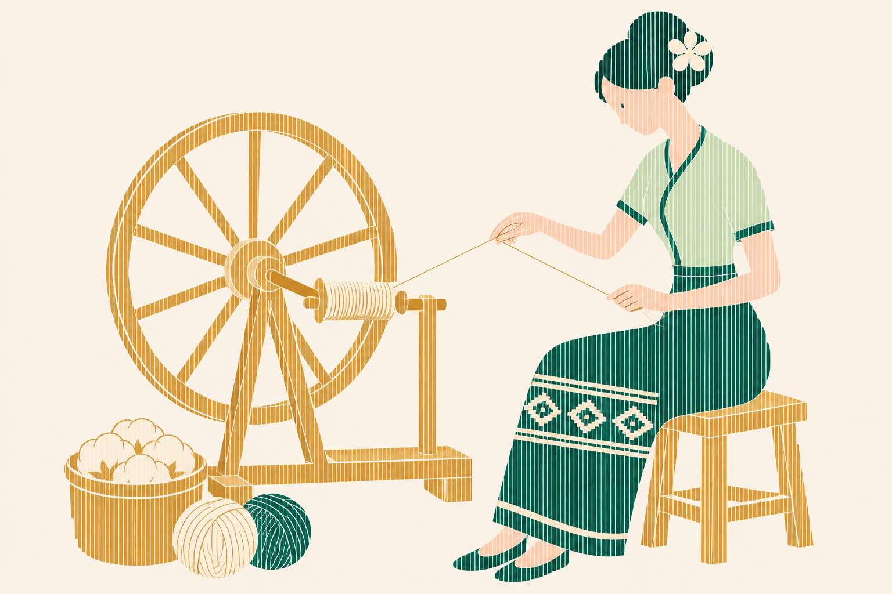
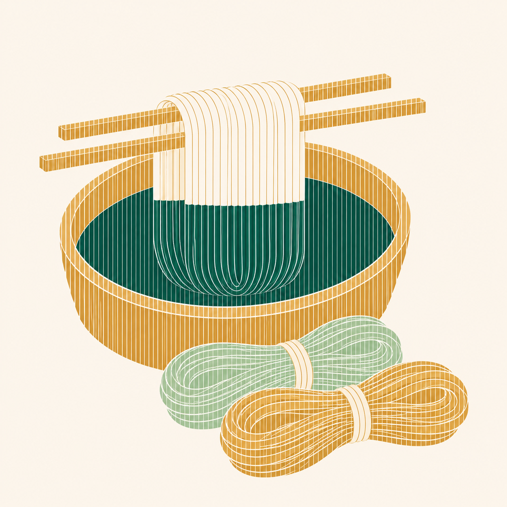
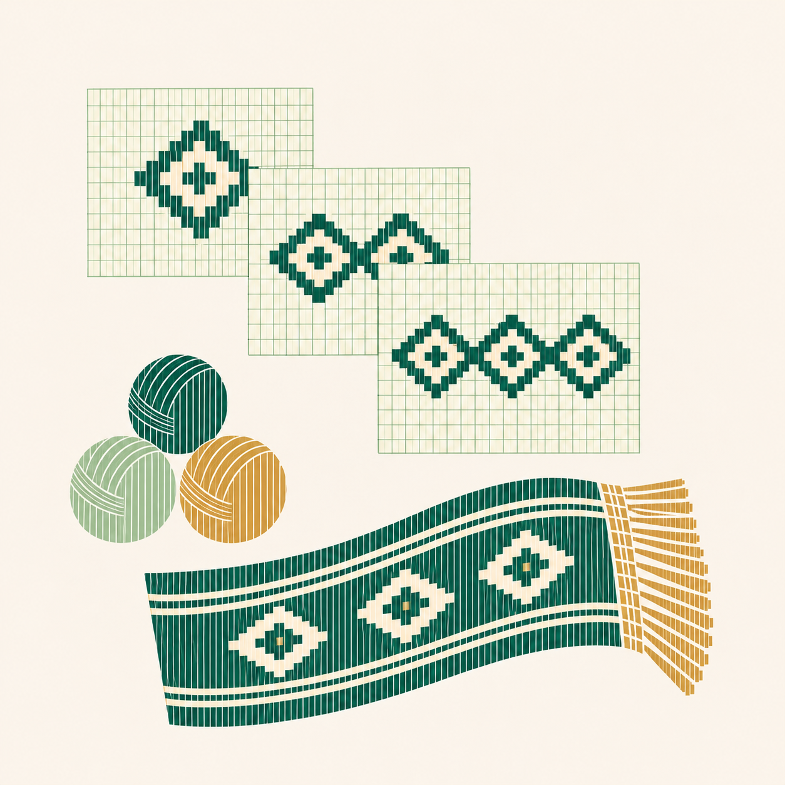

# 傣锦纹录

**云南傣锦文化资源数字化展示与信息可视化课程项目。**

项目以傣锦为线索，把地域记录、制作工艺、纹样档案、色彩关系、互动设计和传承故事组织成可浏览、可检索、可体验的网站。仓库同时保存“傣锦织谱”课程设计使用的两套工艺插图，供后续信息图、PPT 与版面设计继续使用。

[在线体验傣锦纹录](https://daijinwenlu.wang-jingjing.com) · [课程汇报 PDF](coursework/reports/daijinwenlu-visual-report.pdf) · [八章图表实例](coursework/chart-examples/) · [网站文件](website/) · [插图下载包](downloads/)

## 课程汇报与关键视觉

王晶晶、张斯琪以“傣锦怎样织成”和“锦面怎样读”为题，分别设计了《成锦》《识纹》两张 A3 横版草图。第一张用细密织线插画串起材料与纹样准备、上机及织作循环，第二张将纹样档案、取样色卡和分类数量并排展示。

| 查看内容 | 文件 |
| --- | --- |
| 最新视觉汇报，11 页 | [在线阅读 PDF](coursework/reports/daijinwenlu-visual-report.pdf) · [下载可编辑 PowerPoint](coursework/reports/daijinwenlu-visual-report.pptx) |
| 原始设计方案，16 页 | [傣锦织谱 · 王晶晶、张斯琪](coursework/reports/daijinwenlu-original-proposal.pptx) |
| 《成锦》《识纹》两张草图 | [A3 打印版 PDF](coursework/key-visuals/傣锦织谱_两张A3横版关键视觉草图.pdf) · [高清 PNG 与 SVG 源文件](coursework/key-visuals/) |
| 寻源、在地、成锦、识纹、观色、用锦、传艺、续锦 | [八章图表实例、读图方式与原始出处](coursework/chart-examples/) |
| 课程图表与参考作品的使用说明 | [素材来源](coursework/SOURCES.md) |

## 网站内容与功能

| 章节 | 当前实现 |
| --- | --- |
| 展卷 | 进入视口后展开锦卷，支持点击或键盘切换展开、收卷。 |
| 地域溯源 | 云南区域示意图与市县列表联动，展示村寨活动记录、说明及文献来源。 |
| 经纬工艺 | 织造场景热点、六个工艺环节、经纬交织示意；可调整织入进度、暂停和重置。 |
| 纹样档案 | 按几何、植物、动物、建筑、文字五类浏览，按类别、颜色、编号搜索；可打开详情、切换原图、保存图像及收藏。 |
| 纹样关系 | 七种交互图谱：纹样总览、五类色环、主色流向、同图共色、类别色谱、地域记录、明暗层次。支持选择图形或图例、查看对应纹样及统计说明。 |
| 互动转译 | 选择搭配方案或自由组合纹样，制作方巾、书签、长卷；调整构图、底色、密度、间隔与锦边，支持旋转、撤销、重置及 PNG 导出。 |
| 织成作品 | 将当前设计带入木质织机动画，随后查看使用效果或作品卡，并保存 PNG。 |
| 传承故事 | 人物档案、学艺与传习关系、重要事件时间线，附资料出处。 |

页面还包含章节导航、滚动进度、移动端布局及减少动态效果的适配。昵称、收藏与创作草稿保存在**当前浏览器的本地存储**中；此处的“登录”是本机账户体验，不提供云端身份认证或跨设备同步。

## 仓库目录

```text
.
├── README.md
├── coursework/                 # 两份课程 PPT、汇报 PDF、两张 A3 草图与图表实例
├── website/                    # 可直接通过静态 HTTP 服务预览的网站
│   ├── index.html              # 页面结构、章节与资源加载入口
│   ├── site.css                # 全局样式、色板与基础布局
│   ├── site.js                 # 主要页面交互
│   ├── data/                   # 纹样、地域、人物、工序、图谱与工作台数据
│   ├── motion/                 # 展卷、图谱、转译工作台、织机及移动端交互
│   ├── assets/                 # 纹样原图、缩略图、插画、地图、标题等素材
│   ├── charts/                 # 随站点归档的图表素材
│   └── mosaics/                # 纹样拼接图
├── artwork/
│   ├── with-people/            # 6 张人物工艺插图及生成提示词
│   └── objects/                # 8 张无人器物图、提示词及工序来源说明
└── downloads/                  # 两套插图的 ZIP 打包文件
```

`website/` 保存已有网站的静态文件；`artwork/` 保存新制作的插图成品。这两套新图作为独立设计素材归档，并不表示已替换网站内原有的插画资源。

## 本地预览

本项目的网站部分由 HTML、CSS、JavaScript 和静态素材组成，**预览不需要运行 npm 安装或构建**。

安装 Python 3 后，在仓库根目录打开 PowerShell，执行：

```powershell
python -m http.server 8080 --directory website
```

然后用浏览器打开 [http://localhost:8080](http://localhost:8080)。停止预览时，在终端按 `Ctrl+C`。

如果 Windows 使用 Python 启动器，可改用：

```powershell
py -m http.server 8080 --directory website
```

请保留 `website/` 内部的目录关系，并通过 HTTP 地址预览，便于完整检查图片加载、交互与画布导出。浏览器本地收藏和草稿按站点来源分别保存，线上域名与本地预览地址的数据互不共享。

## 工艺插图

两组共 **14 张独立 PNG**。视觉统一采用绿金米白配色、细密竖向织线、平面色块和局部阶梯纹样，均为米白背景。各目录保留 imagegen 生成流程中的提示词，方便继续调整。

[下载人物工艺组（6 张）](downloads/daijinwenlu-people-6.zip) · [下载无人器物组（8 张）](downloads/daijinwenlu-objects-8.zip)

| 系列 | 数量与尺寸 | 表现重点 |
| --- | --- | --- |
| 人物工艺组 | 6 张，1536 × 1024 像素，横版 | 保留正常成年人物比例，以动作和操作情境串联工序。 |
| 无人器物组 | 8 张，1254 × 1254 像素，方版 | 通过材料、器物近景及经纬结构解释过程，与人物组形成不同构图。 |

### 人物工艺组

| 文件 | 内容 |
| --- | --- |
| [01_原料与线材准备.png](artwork/with-people/01_原料与线材准备.png) | 备料与绕线 |
| [02_染线.png](artwork/with-people/02_染线.png) | 线材着色 |
| [03_设计图样.png](artwork/with-people/03_设计图样.png) | 图样安排 |
| [04_制作棉线纹版.png](artwork/with-people/04_制作棉线纹版.png) | 以棉线制作纹版 |
| [05_上机配置经纬.png](artwork/with-people/05_上机配置经纬.png) | 上机配置 |
| [06_织作成锦.png](artwork/with-people/06_织作成锦.png) | 织造情境 |

| 原料与线材准备 | 织作成锦 |
| --- | --- |
|  |  |

### 无人器物组

| 文件 | 内容 |
| --- | --- |
| [01_棉纱准备.png](artwork/objects/01_棉纱准备.png) | 棉絮、纱锭与整理后的线束 |
| [02_染线.png](artwork/objects/02_染线.png) | 染盆、线束与已染线材 |
| [03_理线整经.png](artwork/objects/03_理线整经.png) | 绕经装置与有序排布的经线 |
| [04_图样规划.png](artwork/objects/04_图样规划.png) | 图案基元、连续纹带与配色 |
| [05_编结花本.png](artwork/objects/05_编结花本.png) | 线组与横向记纹线构成的花本示意 |
| [06_上机穿线.png](artwork/objects/06_上机穿线.png) | 经线经过综与筘的结构 |
| [07_开口引纬.png](artwork/objects/07_开口引纬.png) | 经线形成梭口，梭子带入纬线 |
| [08_打纬成锦.png](artwork/objects/08_打纬成锦.png) | 筘向织口推进，锦面逐行形成 |

| 染线 | 图样规划 |
| --- | --- |
|  |  |

八张器物图是为信息可视化拆分的观察模块，可按两条准备线组织：

```text
材料准备：01 棉纱准备 → 02 染线 → 03 理线整经 ┐
纹样准备：04 图样规划 → 05 编结花本          ┘
                         ↓
                  06 上机穿线 → 07 开口引纬 ↔ 08 打纬成锦
```

开口引纬与打纬是反复进行的织造动作。上述安排不表示各地都采用完全相同的八个线性步骤。图样卡片、配色对应与结构拆分是当代信息图表达；详细依据见[工序组织与来源说明](artwork/objects/工序组织与来源说明.txt)。

## 内容编辑位置

| 要修改的内容 | 主要文件 |
| --- | --- |
| 页面文字、章节结构与资源入口 | [website/index.html](website/index.html) |
| 基础色板、字体、全局布局 | [website/site.css](website/site.css) |
| 地图联动、工序热点、档案筛选与本机收藏 | [website/site.js](website/site.js) |
| 地域、人物、工序、时间线与来源记录 | [website/data/site-data.js](website/data/site-data.js) |
| 纹样档案及分类记录 | [website/data/gallery.js](website/data/gallery.js) |
| 图像亮度与对比等分析数据 | [website/data/atlas-image-metrics.js](website/data/atlas-image-metrics.js) |
| 七种图谱及色彩共现关系 | [website/motion/atlas-experience.js](website/motion/atlas-experience.js) |
| 转译工作台使用的纹样与搭配方案 | [website/data/studio-patterns.js](website/data/studio-patterns.js)、[website/data/studio-recipes.js](website/data/studio-recipes.js) |
| 工作台交互与成品导出 | [website/motion/pattern-studio.js](website/motion/pattern-studio.js)、[website/motion/studio-export.js](website/motion/studio-export.js) |
| 木质织机动画、结果页与使用效果 | [website/motion/loom.js](website/motion/loom.js)、[website/motion/loom-experience.js](website/motion/loom-experience.js)、[website/motion/loom-mockup.js](website/motion/loom-mockup.js) |
| 新工艺插图、提示词与制作说明 | [artwork/with-people/](artwork/with-people/)、[artwork/objects/](artwork/objects/) |

调整纹样档案时，应同时检查原图、缩略图与数据记录中的路径及编号；图谱和互动转译也会引用这些记录。新增或替换图像后，相应的图像指标和色彩关系需要重新核对。各交互模块的配套 CSS 位于 `website/motion/`，保持页面中的脚本加载顺序。

## 资料与统计口径

当前归档的站点数据记录了 132 个源图像文件，其中 2 个为拼接总览；图谱统计使用其余 130 幅图像，沿用原目录的五类标签。数量与比例只描述这批档案，不代表所有傣锦的总体分布。

色彩统计来自数字图像的显示色，不等同于实物色度或染料鉴定。地图以市县层级位置承载文献中的村寨与活动记录，不据此推定每张纹样图像的采集地。人物及传习关系依据档案和活动报道组织，具体来源保存在 [site-data.js](website/data/site-data.js) 并显示于网站相关位置。

主要资料入口包括：

- [云南非遗公开课：2024 西双版纳专场](https://www.ynich.cn/live/view/3491.html)：图样设计、棉线纹版、经纬配置与织锦概述。
- [中国非物质文化遗产网：“国家非物质文化遗产”寻踪——傣族织锦](https://www.ihchina.cn/Article/Index/detail?id=11358)：花本、经线开口及投纬循环等工艺记录。
- [中国丝绸博物馆：低花本织机提花技艺相关技术说明](https://chinasilkmuseum.com/gskt/info_319.aspx?itemid=27774)：傣锦机案例、花本、开口、引纬与打纬。
- [中国丝绸博物馆：织造研习记录](https://www.chinasilkmuseum.com/ngcxg/info_11.aspx?itemid=27634)：整经、穿综和穿筘等通用织造结构的辅助参考。
- [国务院第二批国家级非物质文化遗产名录通知](https://zwgk.mct.gov.cn/zfxxgkml/fwzwhyc/202012/t20201210_918992.html)：名录信息。
- [云南省非遗保护网：傣族织锦技艺传承人与生产性保护培训班](https://www.ynich.cn/news/new/1108.html)：传习活动记录。
- [geoBoundaries](https://www.geoboundaries.org/api/current/gbOpen/CHN/ADM1/) 与 [GeoNames](https://www.geonames.org/)：地图边界及地名位置数据来源。

## 图像与使用说明

新增工艺插图由内置 imagegen 辅助生成，并根据设计反馈迭代，用于课程设计、工序解释与视觉排版。**插图属于情境和结构示意，不是特定文物或织机的测绘复原，也不能替代实际织造操作说明。**

本仓库用于项目资料归档与继续编辑，未附带统一的开源授权。第三方纹样图像、文献、地图和其他素材的权利及使用要求以各来源说明为准；仓库归档不改变其原有权利归属。

