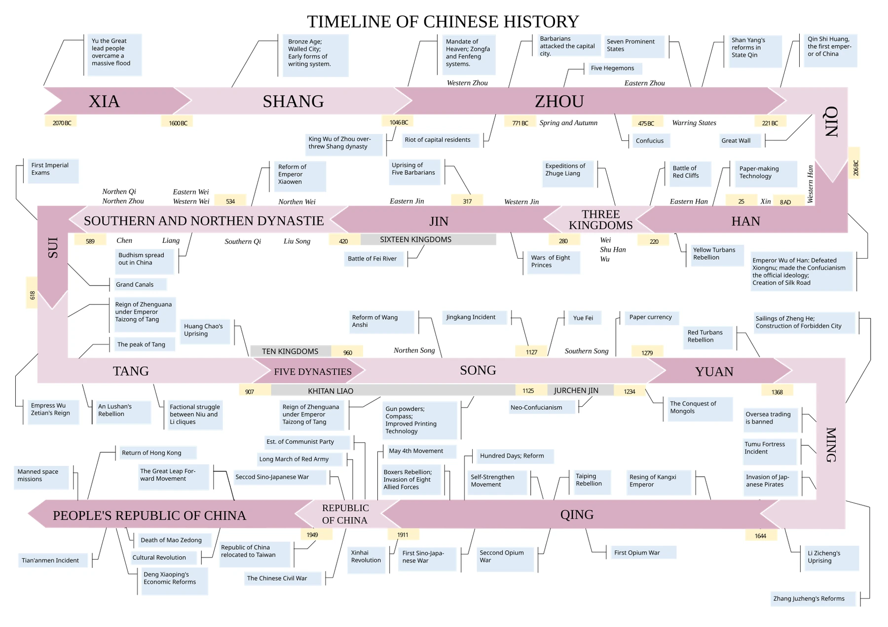
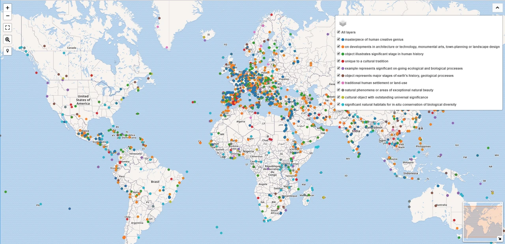
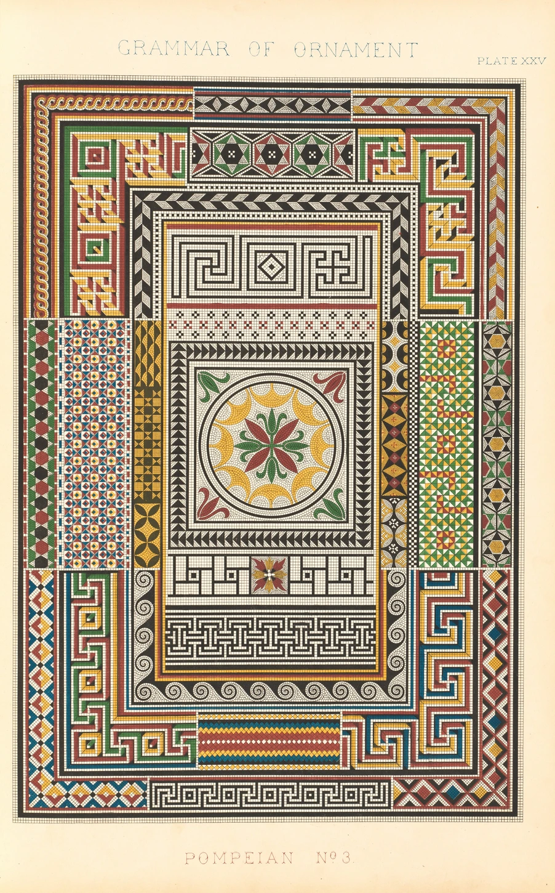
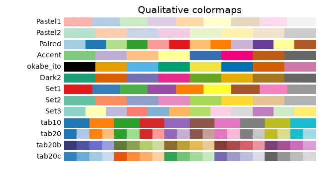
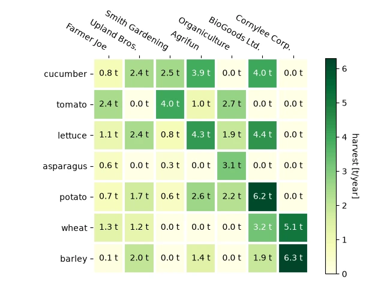
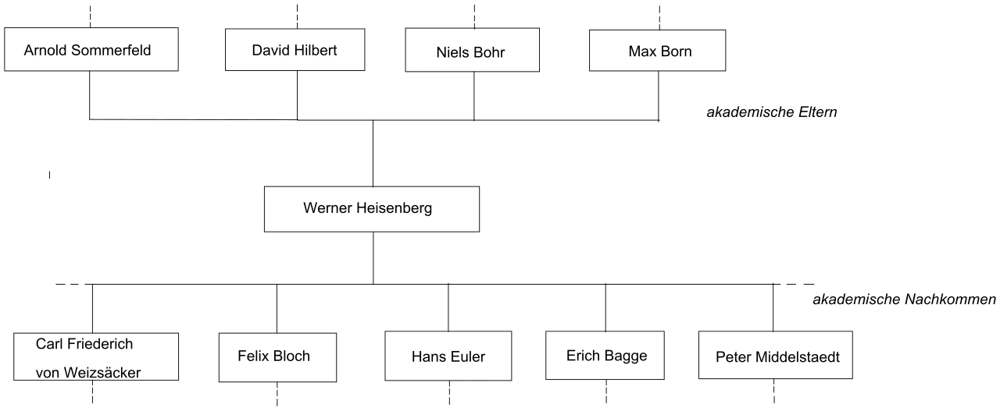
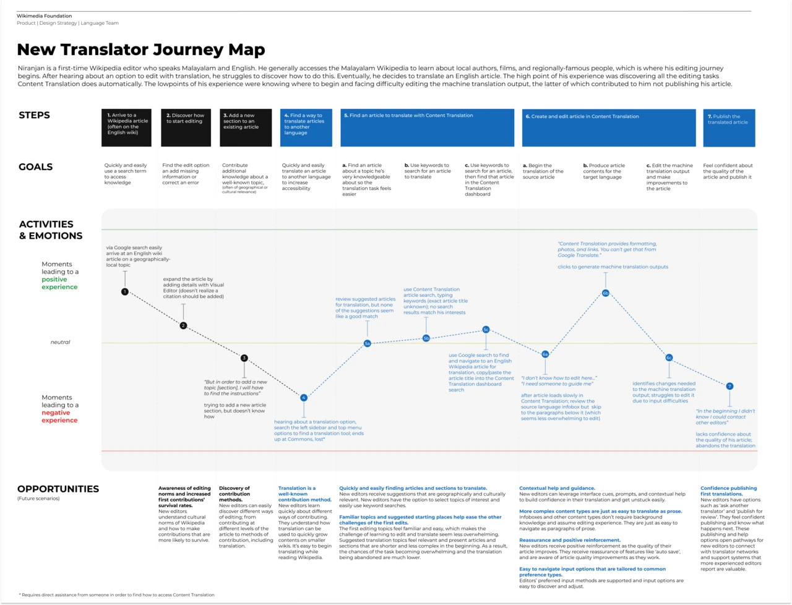

# 八章图表实例｜GitHub 阅读索引

这里整理八种已在外部网站发表的图表形式，对应《傣锦纹录》的八章叙事。图例来自不同领域，仅作编排和读图方法参考，不是傣锦项目的统计或田野数据。

[HTML 单图外链预览版](index.html) · [完整来源说明](../SOURCES.md) · [课程资料目录](../README.md)

下方七幅缩略图与 HTML 中的图像内容一致，仅做等比例缩小和 WebP 转换；“成锦”一项以 Cotton Australia 官方教材链接呈现。此预览处理仅针对图例页面，不对原课堂 PPT 的再分发权限作判断。

| 章节 | 图表形式 | 原始实例 |
| --- | --- | --- |
| 01 寻源 | 历史事件时间轴 | [Timeline of Chinese History](https://commons.wikimedia.org/wiki/File:Timeline_of_Chinese_History.svg) |
| 02 在地 | 分类点位地图 | [Map of World Heritage site colour coded by UNESCO inclusion criteria](https://commons.wikimedia.org/wiki/File:Map_of_World_Heritage_site_colour_coded_by_UNESCO_inclusion_criteria.png) |
| 03 成锦 | 分支与汇合流程图 | [Cotton Education Kit, Chapter 7: Processing: from Gin to Fabric（PDF 第 10 页图表节选）](https://cottonaustralia.com.au/assets/general/Education-resources/CA-resources/CEK_Chap_7_Processing_From_Gin_To_Fabric.pdf#page=10) |
| 04 识纹 | 纹样图版与构成 | [The Grammar of Ornament, Plate XXV: Pompeian No. 3 (1856)](https://www.nga.gov/artworks/102555-grammar-ornament) |
| 05 观色 | 色卡矩阵 | [Qualitative colormaps / Choosing Colormaps in Matplotlib](https://matplotlib.org/stable/users/explain/colors/colormaps.html#qualitative) |
| 06 用锦 | 用途与场景矩阵 | [Annotated heatmap（农民—农场收成矩阵示例）](https://matplotlib.org/stable/gallery/images_contours_and_fields/image_annotated_heatmap.html) |
| 07 传艺 | 人物师承关系图 | [Akademischer Stammbaum Werner Heisenberg (Ausschnitt)](https://commons.wikimedia.org/wiki/File:Akademischer_Stammbaum_Werner_Heisenberg_(Ausschnitt).svg) |
| 08 续锦 | 参与路径与触点 | [New Translator Journey Map (2020-12-08)](https://commons.wikimedia.org/wiki/File:New_Translator_Journey_Map.png) |

## 01 寻源｜历史事件时间轴

**读图：** 沿时间带阅读事件节点，比较分段、色块和事件卡片的排列。

**出处与作者：** [Timeline of Chinese History](https://commons.wikimedia.org/wiki/File:Timeline_of_Chinese_History.svg)，Wilfredor。

**许可：** [CC0 1.0](https://creativecommons.org/publicdomain/zero/1.0/)。

**使用边界：** 历史折返时间轴；只借鉴事件与时间带的组织方式。

## 02 在地｜分类点位地图

**读图：** 点表示位置，颜色表示类别；先看图例，再查空间分布。

**出处与作者：** [Map of World Heritage site colour coded by UNESCO inclusion criteria](https://commons.wikimedia.org/wiki/File:Map_of_World_Heritage_site_colour_coded_by_UNESCO_inclusion_criteria.png)，NavinoEvans。

**许可：** [CC BY-SA 4.0](https://creativecommons.org/licenses/by-sa/4.0/)。

**使用边界：** 2019 年世界遗产分类点位图，不表示当前完整名录或傣锦地域分布。

## 03 成锦｜分支与汇合流程图

**原图外链：** [Cotton Australia《Processing: from Gin to Fabric》第 7 章，PDF 第 10 页](https://cottonaustralia.com.au/assets/general/Education-resources/CA-resources/CEK_Chap_7_Processing_From_Gin_To_Fabric.pdf#page=10)。课堂参考采用该页流程图的节选；此预览索引不嵌入该图。

**读图：** 从官方 PDF 第 10 页观察原料加工、纺纱、织造与后整理之间的分支和汇合。

**出处与作者：** [Cotton Education Kit, Chapter 7: Processing: from Gin to Fabric（PDF 第 10 页图表节选）](https://cottonaustralia.com.au/assets/general/Education-resources/CA-resources/CEK_Chap_7_Processing_From_Gin_To_Fabric.pdf#page=10)，Cotton Australia。

**本页处理：** 官方教材外链；没有在本索引收录其图片或 PDF。

**使用边界：** 课堂原版曾选取棉纺织品生产流程图，用于观察分支与汇合。公开版不包含该节选图或教材 PDF；它不是傣族织锦工序证据。

## 04 识纹｜纹样图版与构成

**读图：** 比较单元纹样、连续边带和复合构成，观察重复规则。

**出处与作者：** [The Grammar of Ornament, Plate XXV: Pompeian No. 3 (1856)](https://www.nga.gov/artworks/102555-grammar-ornament)，Owen Jones；Francis Bedford（石印）；National Gallery of Art, Washington（馆藏数字图）。

**许可：** [Public domain（馆方原页面标注）](https://www.nga.gov/artworks/102555-grammar-ornament)。

**使用边界：** Mark J. Millard Architectural Collection，1997.109.1。庞贝装饰图版，作为重复单元与连续纹带的组织参考，不是傣族纹样。

## 05 观色｜色卡矩阵

**读图：** 每行是一组配色方案，可直接比较相邻色与组间差异。

**出处与作者：** [Qualitative colormaps / Choosing Colormaps in Matplotlib](https://matplotlib.org/stable/users/explain/colors/colormaps.html#qualitative)，Matplotlib Development Team。

**许可：** [Matplotlib License（基于 PSF）](https://matplotlib.org/stable/project/license.html)。

**使用边界：** 离散色卡的并列展示，不是傣锦色彩占比或共现统计。

## 06 用锦｜用途与场景矩阵

**读图：** 横向看农场、纵向看农民，在交叉单元格读取教程中的示例数值。

**出处与作者：** [Annotated heatmap（农民—农场收成矩阵示例）](https://matplotlib.org/stable/gallery/images_contours_and_fields/image_annotated_heatmap.html)，Matplotlib Development Team。

**许可：** [Matplotlib License（基于 PSF）](https://matplotlib.org/stable/project/license.html)。

**使用边界：** 官方教程的示例数据，借鉴行列交叉与单元格标注，不是真实傣锦产品—场景记录。

## 07 传艺｜人物师承关系图

.svg)

**读图：** 沿连线查找导师、人物与学生；一条连线对应一项谱系关系。

**出处与作者：** [Akademischer Stammbaum Werner Heisenberg (Ausschnitt)](https://commons.wikimedia.org/wiki/File:Akademischer_Stammbaum_Werner_Heisenberg_(Ausschnitt).svg)，Elrond。

**许可：** [CC BY-SA 4.0](https://creativecommons.org/licenses/by-sa/4.0/)。

**使用边界：** 海森堡学术谱系节选，用于理解人物节点和师承连线，不是傣锦传承人物。

## 08 续锦｜参与路径与触点

**读图：** 从左到右看参与阶段，再纵向查看目标、行为、体验与机会。

**出处与作者：** [New Translator Journey Map (2020-12-08)](https://commons.wikimedia.org/wiki/File:New_Translator_Journey_Map.png)，EAsikingarmager (WMF)。

**许可：** [CC BY-SA 4.0](https://creativecommons.org/licenses/by-sa/4.0/)。

**使用边界：** 基于多个新编辑观察模式的多语编辑研究图，不代表所有编辑或本项目网站的实测用户旅程。

七幅收录图例分别保留原作者的许可。改编 CC BY-SA 图例时须注明修改并遵守相同或兼容许可；Matplotlib 图例保留 [许可与版权文本](../licenses/Matplotlib-LICENSE.txt)。本索引不将各素材统一转授许可。
